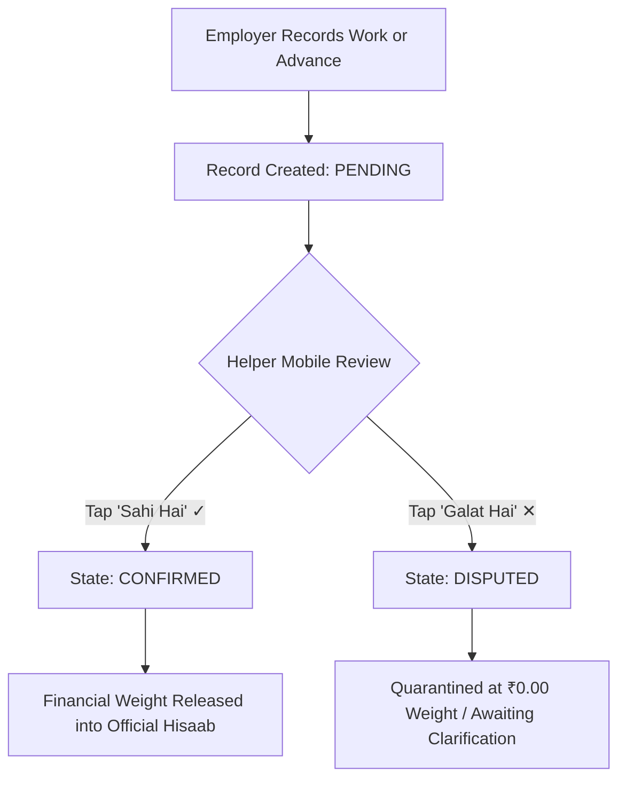
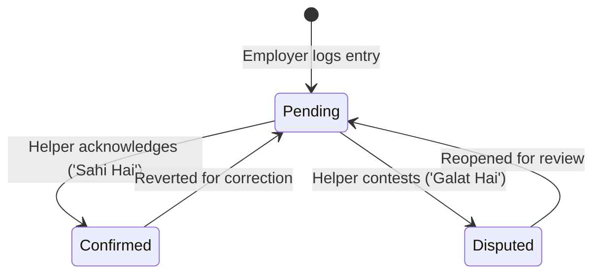
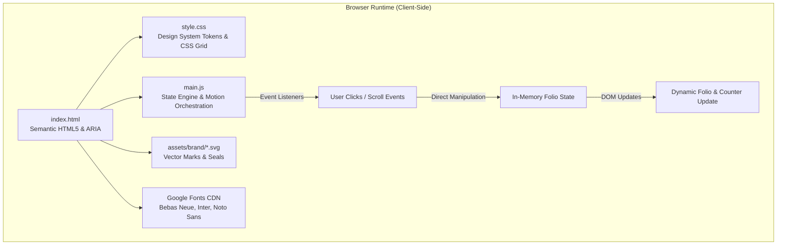
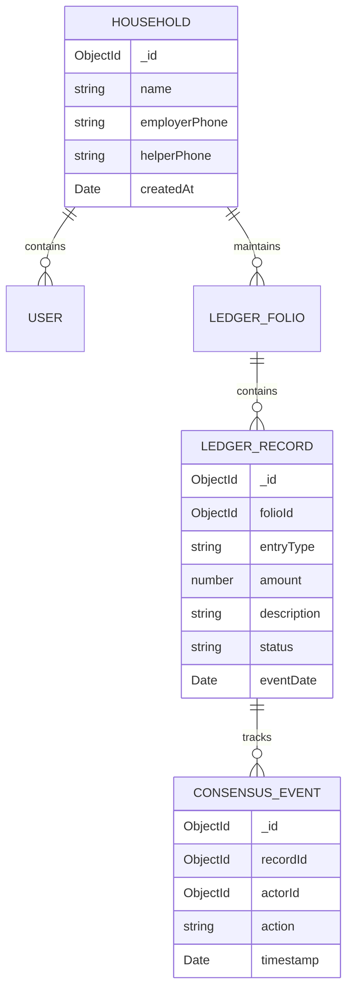

# SevaKhata (सेवाखाता)

> **"Dono ka record, ek hi hisaab."**  
> *Jo dono maane, wahi hisaab.*

SevaKhata is a shared digital work-and-payment ledger designed for domestic employment relationships (employers and domestic helpers). It establishes a single, mutually acknowledged source of truth for attendance, daily work, cash advances (*pesgi*), payments, and month-end settlement (*hisaab*).

The name reflects its core mission:
- **Seva (सेवा):** Service, domestic assistance, and household labor.
- **Khata (खाता):** Account book, traditional Indian ledger (*bahi-khata*), and financial register.

Unlike conventional unilateral tracking tools, SevaKhata operates on a strict **bilateral consensus model**: an entry recorded by an employer enters a quarantined **Pending** state and contributes to the official balance if and only if the helper acknowledges it (**Confirmed**).

---

## Table of Contents

1. [Product Overview](#product-overview)
2. [Problem Statement](#problem-statement)
3. [The Consensus Solution](#the-consensus-solution)
4. [Domain Model & Entity Lifecycle](#domain-model--entity-lifecycle)
5. [Record State Machine](#record-state-machine)
6. [Hisaab Calculation Logic](#hisaab-calculation-logic)
7. [Current Implementation Status](#current-implementation-status)
8. [Feature Matrix](#feature-matrix)
9. [Product Role Model & Responsibilities](#product-role-model--responsibilities)
10. [Bilingual UX & Typography](#bilingual-ux--typography)
11. [System Architecture](#system-architecture)
12. [Technology Stack](#technology-stack)
13. [Frontend Architecture](#frontend-architecture)
14. [Interaction Model & Motion Engine](#interaction-model--motion-engine)
15. [Data Flow](#data-flow)
16. [Conceptual Data Model (Proposed Future Backend)](#conceptual-data-model-proposed-future-backend)
17. [Repository Structure](#repository-structure)
18. [Local Setup & Execution](#local-setup--execution)
19. [Testing & Quality Assurance](#testing--quality-assurance)
20. [Accessibility & Responsive Design](#accessibility--responsive-design)
21. [Security, Privacy & Data Integrity](#security-privacy--data-integrity)
22. [Known Limitations](#known-limitations)
23. [Future Engineering Roadmap](#future-engineering-roadmap)
24. [Design System Reference](#design-system-reference)

---

## Product Overview

Domestic employment in India typically operates without formal written contracts, digital accounting, or synchronized records. Employers often note days in kitchen calendars or personal smartphone notes, while helpers maintain mental tallies or rely on memory. Mid-month cash handovers for school fees, medical emergencies, or grocery advances (*pesgi*) frequently occur without physical receipts.

At month-end settlement, discrepancies in dates, substitute days, half-days, or unrecorded cash handovers create friction, awkward negotiations, and eroded trust.

SevaKhata resolves this structural problem not by introducing complex enterprise payroll software, but by introducing a **shared, bilateral ledger**:

```
        TWO PARTICIPANTS  ──▶  ONE SHARED RECORD  ──▶  ONE MUTUAL HISAAB
(Employer & Domestic Helper)      (Transparent Ledger)       (Confirmed Net Balance)
```

---

## Problem Statement

| Traditional Method | Failure Mode | Impact on Relationship |
| :--- | :--- | :--- |
| **Wall Calendar Tick Marks** | Pencil marks cannot capture half-days, extra chores, or substitute staff. Marks are vulnerable to loss or dispute. | Ambiguity around which dates were worked or missed. |
| **Doorway Cash Advances (*Pesgi*)** | Cash given during morning departures without timestamps or receipts. By month-end, amounts are remembered differently. | Disagreements over whether an advance was ₹500 or ₹1,000. |
| **Personal Phone Notes** | Kept solely on the employer's device; invisible to the helper until the final settlement day. | Helper feels excluded from their own earning records. |
| **Memory / Unwritten Recall** | Relying on recall over 30 days inevitably produces cognitive bias and recall errors. | Awkward arguments on the 1st of every month; loss of dignity. |

**Core Technical Cause:** The absence of a shared, concurrent state between the two participating stakeholders.

---

## The Consensus Solution

SevaKhata enforces an **asymmetric recording and symmetric acknowledgement** workflow:

1. **Recording Phase:** The employer logs daily work, attendance, or cash advance entries.
2. **Quarantine Phase:** The newly created record is tagged `PENDING`. It is strictly quarantined with **₹0.00 weight** on the official running balance.
3. **Verification Phase:** The domestic helper receives the entry for review in clear Hindi/Devanagari on their mobile interface.
4. **Resolution Phase:**
   - **Confirm (*Sahi Hai · सही है*):** The entry transitions to `CONFIRMED`. Its financial value is released from quarantine and added to the official *Hisaab*.
   - **Dispute (*Galat Hai · गलत है*):** The entry transitions to `DISPUTED`. It remains in quarantine at ₹0.00 financial weight until reconciled.



---

## Domain Model & Entity Lifecycle

The SevaKhata domain centers on the **Mutual Ledger Folio**, which binds two human actors into a single accounting context.

### 1. Primary Actors
- **Employer:** Household account manager authorized to log attendance, overtime, special tasks, cash advances, and monthly settlements.
- **Helper:** Domestic worker authorized to review, verify, or contest entries associated with their service.

### 2. Primary Domain Entity: `LedgerRecord`
Every financial or attendance event within a monthly folio constitutes a distinct record:

| Record Type | Financial Polarity | Description |
| :--- | :--- | :--- |
| **Work Attendance** | Positive Credit (`+₹`) | Standard full-day or half-day household work, cooking, cleaning, or childcare. |
| **Cash Advance (*Pesgi*)** | Negative Debit (`−₹`) | Mid-month cash handovers for personal, medical, or family requirements. |
| **Payment (*Bhugtan*)** | Negative Debit (`−₹`) | Formal mid-month or partial payments. |
| **Bonus / Overtime** | Positive Credit (`+₹`) | Festival bonuses (Diwali, Eid), deep cleaning, or guest cooking. |
| **Adjustment** | Variable (`±₹`) | Reconciled corrections agreed upon by both participants. |

---

## Record State Machine

A ledger entry exists in exactly one of three distinct operational states:



### State Specifications

| State | Financial Weight on Hisaab | UI Representation | Behavioral Rules |
| :--- | :--- | :--- | :--- |
| **`PENDING`** | **₹0.00 (Quarantined)** | Amber Badge / Pulsing Indicator | Visible in the ledger folio with an explanatory footnote. Cannot modify the running payable balance. |
| **`CONFIRMED`** | **Active Value (`±₹Amount`)** | Emerald Badge / Dual Checkmark | Value is committed to the shared running balance. Both participants share identical state. |
| **`DISPUTED`** | **₹0.00 (Quarantined)** | Rose Badge / Warning Icon | Entry is flagged for verbal clarification. Held off the official balance to prevent erroneous deductions or inflations. |

---

## Hisaab Calculation Logic

The running payable balance (*Shared Hisaab*) is computed strictly from mutually acknowledged records:

$$\text{Official Hisaab} = \sum \text{Confirmed Work} + \sum \text{Confirmed Bonuses} \pm \sum \text{Confirmed Adjustments} - \sum \text{Confirmed Advances} - \sum \text{Confirmed Payments}$$

$$\text{Pending Records} \times 0.00 + \text{Disputed Records} \times 0.00 = 0.00$$

*Note on adjustments:* Confirmed adjustments contribute according to their signed polarity ($\pm₹$), while unconfirmed records (Pending or Disputed) hold strictly zero weight on the official balance.

### Demonstration Dataset

The interactive prototype embedded in [`index.html`](./index.html) and [`main.js`](./main.js) demonstrates this logic using a static demonstration scenario for *Sharma Household × Sunita Sharma (August 2026)*:

1. **Historical Confirmed Work:** 8 Full Days Housework & Cooking $= \mathbf{+₹4,000}$ *(Confirmed)*
2. **Historical Confirmed Advance:** 05 Aug School Fee Advance $= \mathbf{-₹1,000}$ *(Confirmed / Deducted)*
3. **Baseline Running Balance:** $+₹4,000 - ₹1,000 = \mathbf{₹3,000}$
4. **Active Today Record (13 Aug):** Full Day Housework $= \mathbf{+₹500}$
   - **Initial State (`PENDING`):** Weight $= ₹0.00 \implies \text{Running Total} = \mathbf{₹3,000}$
   - **User taps `Sahi Hai · सही है` (`CONFIRMED`):** Weight $= +₹500 \implies \text{Running Total} = \mathbf{₹3,500}$
   - **User taps `Galat Hai · गलत है` (`DISPUTED`):** Weight $= ₹0.00 \implies \text{Running Total} = \mathbf{₹3,000}$

---

## Current Implementation Status

> [!NOTE]
> **Prototype Scope Notice:** This repository currently contains a **high-fidelity interactive frontend prototype and design specification**. It serves as the design system, client-side interaction engine, and architectural blueprint. A persistent backend server (Node.js/Express) and database persistence (MongoDB/Mongoose) are planned for subsequent development phases.

| System Layer | Current Status | Description |
| :--- | :--- | :--- |
| **Frontend Presentation** | **Implemented** | High-fidelity, editorial 5-movement landing page built with semantic HTML5 and custom CSS tokens. |
| **Interactive Consensus Engine** | **Prototype** | Client-side reactive state machine in vanilla JavaScript simulating `Pending`, `Confirmed`, and `Disputed` transitions. |
| **Motion & Scroll Choreography** | **Implemented** | Spatial scroll staging, two-sided memory parallax, and cubic ease-out counter animations. |
| **Bilingual UI** | **Implemented** | English and Hindi (Devanagari) embedded directly in typographic hierarchies. |
| **Figma Vector Suite** | **Implemented** | Unlocked, non-flattened vector artboards and design tokens in [`design/`](./design/). |
| **Backend REST API** | **Planned** | Node.js / Express routes for managing households, records, and authentication sessions. |
| **Database Persistence** | **Planned** | MongoDB collections for multi-tenant accounts, transaction ledgers, and audit trails. |
| **Multi-Device Synchronization** | **Planned** | Server-coordinated push updates (WebSockets / Server-Sent Events / SMS triggers). |

---

## Feature Matrix

| Feature | Description | Status | Reference |
| :--- | :--- | :--- | :--- |
| **Bilateral Folio Display** | Living ledger showing employer, helper, active period, and historical entries. | **Implemented** | [`index.html`](./index.html) |
| **Direct Manipulation Verification** | Interactive `✓ Sahi Hai` and `✕ Galat Hai` controls updating state and balances. | **Prototype** | [`main.js`](./main.js) |
| **Cubic Ease-Out Counter** | Smooth mathematical balance ticker updating from ₹3,000 $\leftrightarrow$ ₹3,500. | **Implemented** | [`main.js`](./main.js) |
| **Consensus Lifecycle Stepper** | Interactive 3-stage morphing record: Logged $\rightarrow$ Review Prompt $\rightarrow$ Sealed Hisaab. | **Implemented** | [`main.js`](./main.js) |
| **Two-Sided Memory Parallax** | Visual juxtaposition of employer calendar vs. helper cash advance with scroll convergence. | **Implemented** | [`main.js`](./main.js) |
| **Optical Typography Stack** | Pairings of Bebas Neue, Inter, Noto Sans Devanagari, and Tiro Devanagari. | **Implemented** | [`style.css`](./style.css) |
| **Responsive Folio Adaptation** | Desktop (1440px), tablet (1024px), and mobile (390px) responsive layouts. | **Implemented** | [`style.css`](./style.css) |
| **Reduced Motion Support** | Full compliance with `prefers-reduced-motion` to disable scroll physics and transitions. | **Implemented** | [`style.css`](./style.css), [`main.js`](./main.js) |
| **User Authentication** | Mobile OTP / password-based login for employers and helpers. | **Planned** | Future Phase |
| **Cloud Database Storage** | Multi-household persistence in MongoDB. | **Planned** | Future Phase |
| **WhatsApp / SMS Notifications** | Automated daily verification prompts sent to the helper's mobile number. | **Planned** | Future Phase |

---

## Product Role Model & Responsibilities

```
+------------------------------------+------------------------------------+
|           EMPLOYER ROLE            |            HELPER ROLE             |
+------------------------------------+------------------------------------+
| • Create monthly household folio   | • Review pending records on phone  |
| • Record daily work attendance     | • Acknowledge entry ('Sahi Hai')   |
| • Record cash advances (pesgi)     | • Contest entry ('Galat Hai')      |
| • Record month-end payouts         | • View net confirmed hisaab        |
| • View full audit history          | • Access historical payment log    |
+------------------------------------+------------------------------------+
```

*Note on current prototype:* These represent the intended product domain roles. The current frontend prototype does not enforce server-side access control or session authentication; both perspectives are rendered within a unified demonstration canvas to showcase the bilateral lifecycle without requiring dual devices.

---

## Bilingual UX & Typography

SevaKhata treats Hindi (Devanagari) as a **first-class design element**, avoiding secondary sub-labels or bracketed afterthoughts.

### Key Vocabulary Lockups
- **Payment:** भुगतान (*Bhugtan*)
- **Advance / Cash Handover:** अग्रिम / पेसगी (*Pesgi*)
- **Confirmation:** पुष्टि करें / सही है (*Sahi Hai*)
- **Dispute:** आपत्ति दर्ज करें / गलत है (*Galat Hai*)
- **Pending State:** लंबित (*Lambit* — ₹0.00 weight)
- **Confirmed State:** पुष्टि की गई (*Pushti Ki Gayi*)
- **Shared Hisaab:** साझा हिसाब (*Sajha Hisaab*)

### Typography Hierarchy

| Role | Font Family | Character Set | Purpose | Source |
| :--- | :--- | :--- | :--- | :--- |
| **Monumental Display** | `Bebas Neue` | Latin / Numerals | High-impact headlines, section kickers, monumental totals (`₹3,000`). | Remote Google Fonts |
| **Editorial Body & UI** | `Inter` | Latin / Numerals | System navigation, gridded ledger cells, metadata, telemetry notes. | Remote Google Fonts |
| **Primary Devanagari** | `Noto Sans Devanagari` | Hindi / Devanagari | UI action labels (`सही है`, `गलत है`), subtitles, role descriptors. | Remote Google Fonts |
| **Traditional Devanagari** | `Tiro Devanagari Hindi` | Hindi / Devanagari | Cultural axioms (*"जो दोनों मानें, वही हिसाब"*). | Remote Google Fonts |

*Architecture Note:* Bilingual strings are currently declared directly in the HTML template. An external internationalization library (e.g., `i18next`) is planned when multi-language support expands to Marathi, Bengali, and Tamil.

---

## System Architecture

The current repository represents a static client-side prototype requiring no server-side compilation or package installation:



---

## Technology Stack

| Layer | Technology | Status | Purpose |
| :--- | :--- | :--- | :--- |
| **Markup & Semantics** | HTML5 | Implemented | Structural landmarks (`<main>`, `<header>`, `<article>`, `<section>`, `<nav>`, `<footer>`), ARIA attributes. |
| **Styling & Layout** | Vanilla CSS3 | Implemented | CSS Custom Properties (Tokens), CSS Grid (4-column folio ledger), Flexbox, hardware-accelerated transforms. |
| **Scripting & Logic** | Vanilla ECMAScript (ES6+) | Implemented | Client-side reactive state engine, DOM mutation, `requestAnimationFrame` cubic ease-out loop. |
| **External Typography** | Google Fonts API | Remote CDN | Bebas Neue, Inter, Noto Sans Devanagari, Tiro Devanagari Hindi (loaded via `<link>` in `index.html`). |
| **Vector Graphics** | SVG 1.1 | Implemented | Custom brand marks (`sevakhata-mark.svg`), rotating seal stamps, audit reticles. |
| **Design Suite** | Figma / SVG Specification | Implemented | Unlocked vector representations matching the 1440px desktop, tablet, and mobile layouts. |

---

## Frontend Architecture

The frontend is structured into **five sequential narrative movements**, transforming abstract accounting logic into an intuitive visual story:

```
[System Navigation Bar]
  ├── Brand Lockup (SVG Mark + Bilingual Title)
  ├── Live Telemetry Pill (Household Context)
  └── Threshold Controls (Quick Anchor Jumps)

Movement 01: The Monumental Reveal & Living Ledger Folio (#hero)
  ├── Hero Art Stage (Concentric Crimson Seal Disk + Unobscured Title)
  └── Living Khata Slab Stage (4-Column Ledger Grid + Active Today Row + Running Balance)

Movement 02: The Unilateral Fracture (#diagnostic)
  ├── Left: Employer Kitchen Wall Calendar (Unverified Tick Marks)
  ├── Center: Convergence Axis (VS Beacon Tension Wire)
  └── Right: Helper Doorway Advance (Unreceipted Cash Memory)

Movement 03: The Consensus Engine (#consensus)
  ├── Typographic Composition: RECORDED BY EMPLOYER × REVIEWED BY HELPER
  ├── Stepper Navigation: Logged -> Mobile Review -> Sealed Hisaab
  └── Shared-Element Morphing Card: Evolving Status, Badges, and Financial Weight

Movement 04: The Shared Hisaab Climax (#hisaab)
  ├── Transparent Equation Strip: (+₹4,000) − (−₹1,000) = ₹3,000
  ├── Monumental Display Numeral: ₹3,000 with Dual Acknowledgement Indicators
  └── Month-End Payout Readiness Indicator

Movement 05: The Household Covenant & Closing
  ├── Cultural Proverb: "अगली पेसगी, रसीद के साथ। अगला महीना, बिना संकोच।"
  └── Primary Action Button: "Open the Shared Khata"

[Editorial Footer]
```

---

## Interaction Model & Motion Engine

Interactive behaviors in [`main.js`](./main.js) prioritize tangible feedback, interruptible animations, and purposeful motion:

### 1. Direct Manipulation Verification Loop
Implemented in `initHeroConsensusInteraction()` in [`main.js`](./main.js):
- **Tactile Click Feedback:** Buttons compress on tap (`scale(0.96)`) for 120ms.
- **State Toggle:** Clicking `✓ Sahi Hai` transitions the active record between `pending` and `confirmed`. Clicking `✕ Galat Hai` transitions between `pending` and `disputed`.
- **Causal UI Updates:**
  - Active row boundary highlights emerald (`confirmed`) or rose (`disputed`).
  - Quarantine badge updates from `PENDING` $\rightarrow$ `CONFIRMED` or `DISPUTED`.
  - Explanatory footnote dynamically explains why the entry is or is not contributing to the balance.
  - Formula string updates synchronously (`+₹4,000` vs. `+₹4,500`).

### 2. Cubic Ease-Out Numerical Counter
Implemented in `animateCounter()` in [`main.js`](./main.js):
- Employs a cubic ease-out interpolation curve:
  $$\text{ease}(p) = 1 - (1 - p)^3, \quad p = \min\left(\frac{\Delta t}{\text{duration}}, 1\right)$$
- Over a fixed duration of 320ms, it updates three synchronized DOM nodes: the slab running ticker, the climax equation result, and the monumental climax numeral.
- Formats numbers according to Indian grouping conventions (`toLocaleString('en-IN')`).

### 3. Staged Scroll Choreography
Implemented in `initHeroScrollChoreography()` in [`main.js`](./main.js):
- Unobscured hero title breathes in full negative space on page load.
- On scroll, title scales smoothly ($1.0 \rightarrow 0.96$), translates along Y, and gently dims to let the gridded ledger slab become the focal center.

### 4. Dynamic Two-Sided Parallax
Implemented in `initTwoSidedMemoryParallax()` in [`main.js`](./main.js):
- Calculates viewport scroll progress through Movement 02.
- Shifts employer and helper perspective cards inward toward the central vertical axis to visually demonstrate divergence resolving into unity.

---

## Data Flow

```
[User Action: Click 'Sahi Hai · सही है']
               │
               ▼
[DOM Click Event Listener in main.js]
               │
               ▼
[State Machine Evaluation: currentState = 'confirmed']
               │
               ▼
[Synchronous DOM Updates]
 ├── activeRecord.classList.add('state-confirmed')
 ├── quarantinePill.className = 'semantic-state-pill confirmed'
 ├── weightNote.textContent = '✓ Confirmed by Sunita Didi...'
 └── sealPill.style.borderColor = var(--emerald-core)
               │
               ▼
[requestAnimationFrame Cubic Ease-Out Loop]
 ├── Calculate ease step: 1 - (1 - progress)^3
 ├── Format number: '₹3,500'
 └── Synchronize: #runningTotalNumber, #equationResult, #climaxNumeral
```

---

## Conceptual Data Model (Proposed Future Backend)

When the planned backend service is integrated, the domain will map to MongoDB collections via Mongoose:



### Proposed Entity Schema Definitions

| Entity | Purpose | Key Fields | Relationships |
| :--- | :--- | :--- | :--- |
| **`Household`** | Represents the employment agreement. | `_id`, `name`, `employerId`, `helperId`, `salaryBase`, `status`, `createdAt` | References `User` (Employer & Helper). |
| **`LedgerFolio`** | Monthly billing container (e.g., Aug 2026). | `_id`, `householdId`, `month`, `year`, `confirmedBalance`, `isClosed` | Belongs to `Household`; contains `LedgerRecords`. |
| **`LedgerRecord`** | Individual daily work or financial event. | `_id`, `folioId`, `entryType`, `amount`, `status` (`pending`, `confirmed`, `disputed`), `recordedBy` | Belongs to `LedgerFolio`. |
| **`ConsensusEvent`** | Audit trail of review actions. | `_id`, `recordId`, `actorId`, `action` (`confirm`, `dispute`), `timestamp`, `note` | Belongs to `LedgerRecord`. |

---

## Repository Structure

```
SevaKhata Final/
├── .agents/                                # Agent skills and engineering knowledge base
│   └── skills/                             # Animation and design engineering guides
├── assets/
│   └── brand/                              # Brand vector identity assets
│       ├── favicon.svg                     # Browser favicon
│       ├── sevakhata-mark.svg              # Primary brand mark (crimson ledger spine)
│       ├── sevakhata-seal-stamp.svg        # Circular rotating mutual agreement seal
│       └── sevakhata-wordmark.svg          # Stylized brand typographic mark
├── design/                                 # Figma-compatible vector design suite
│   ├── 00_cover_figma.svg                  # Document cover and release metadata
│   ├── 01_desktop_1440_figma.svg           # Desktop 1440px master vector canvas
│   ├── 02_tablet_1024_figma.svg            # Tablet 1024px responsive canvas
│   ├── 03_mobile_390_figma.svg             # Mobile 390px responsive canvas
│   ├── 04_components_figma.svg             # Component library & interactive states
│   ├── 05_design_system_tokens_figma.svg   # Color variables, type ladder, spacing scale
│   ├── 06_motion_scroll_states_figma.svg   # Motion choreography specifications
│   ├── FIGMA_DESIGN_SYSTEM.md              # Figma import guide and layout documentation
│   └── sevakhata-landing-figma.svg         # Synced master artboard
├── actual_metrics_1440.json                # Measured layout coordinates from QA rendering
├── index.html                              # Primary semantic HTML5 application file
├── main.js                                 # Client-side state machine & motion engine
├── skills-lock.json                        # Skill dependency lockfile
├── style.css                               # Master stylesheet & CSS custom properties
├── walkthrough.md                          # Implementation summary and verification report
└── README.md                               # Project engineering documentation
```

---

## Local Setup & Execution

No local npm package dependencies or build toolchains are required to run the current prototype. The application loads web fonts remotely from Google Fonts (`Bebas Neue`, `Inter`, `Noto Sans Devanagari`, `Tiro Devanagari Hindi`).

### Option 1: Direct Browser File Opening (No Server Required)
Open [`index.html`](./index.html) directly in any modern web browser (Chrome, Safari, Firefox, Edge).

### Option 2: Python Built-in HTTP Server (Optional Local Server)
From the project root directory:

```bash
# Python 3.x
python -m http.server 8000
```
Navigate to `http://localhost:8000`.

### Option 3: Node.js Static Server (Optional)
If Node.js is available:

```bash
npx serve .
```

---

## Testing & Quality Assurance

> [!NOTE]
> Automated unit or end-to-end test suites (e.g., Jest, Playwright, Cypress) are not currently included in the repository.

### Manual Verification Conducted

1. **Direct Manipulation State Machine Verification:**
   - Evaluated `✓ Sahi Hai` click: verified row visual state transitions to emerald, quarantine badge turns `CONFIRMED`, and cubic ease-out counter increments from ₹3,000 to ₹3,500 across all 3 ticker targets.
   - Evaluated `✕ Galat Hai` click: verified row visual state transitions to rose, quarantine badge turns `DISPUTED`, and balance remains invariant at ₹3,000.
2. **Scroll Choreography Verification:**
   - Verified that `hero-art-stage` and `hero-slab-stage` do not collide or occlude text on vertical scroll.
3. **Responsive Breakpoint Testing:**
   - Desktop ($1440 \times 900\text{px}$)
   - Tablet ($1024 \times 768\text{px}$)
   - Mobile ($390 \times 844\text{px}$) — verified zero horizontal overflow (`overflow-x: hidden`).
4. **Figma Vector Suite Verification:**
   - Evaluated the vector artboards in [`design/`](./design/) to ensure structured layer hierarchies and native `<text>` elements for English and Devanagari copy when imported into Figma.

---

## Accessibility & Responsive Design

### Accessibility Considerations & Targeted Standards
- **Semantic Landmark Roles:** `<header role="banner">`, `<nav aria-label="Primary Navigation">`, `<main id="mainCanvas">`, `<article aria-labelledby="...">`, `<footer role="contentinfo">`.
- **Screen Reader Context:** State pill dots and decorative vector seals are declared with `aria-hidden="true"`.
- **Live Status Announcements:** Navigation telemetry declared with `role="status"` and `aria-live="polite"`.
- **Touch Ergonomics:** All interactive buttons on mobile viewports adhere to a minimum touch target height of **48px**.
- **Reduced Motion Support:** A dedicated `@media (prefers-reduced-motion: reduce)` block in [`style.css`](./style.css) and a check in [`main.js`](./main.js) disable parallax shifts, scroll transforms, and animations when users enable reduced-motion operating system preferences.

*Note:* While the prototype incorporates accessibility-oriented markup and styling, it has not undergone a formal third-party WCAG compliance certification.

### Responsive Breakpoints

| Breakpoint | Target Devices | Layout Adaptations |
| :--- | :--- | :--- |
| **`> 1024px`** | Desktop Workstations | 4-column ledger slab (`36px 1fr 120px 110px`), side-by-side memory cards with central tension wire. |
| **`768px – 1023px`** | Tablets & Small Laptops | Adaptive 880px slab width, compressed masthead, stacked telemetry. |
| **`< 768px`** | Mobile Smartphones | Single-column stacked cards, full-width action buttons (48px height), vertical typographic lockup. |

---

## Security, Privacy & Data Integrity

### Current Prototype Scope
- The current implementation operates **entirely within local browser memory**.
- No credentials, session tokens, or personal identifiers are stored or transmitted across a network.
- Application state resets to default values upon page reload.
- Confirmation indicators in the UI demonstrate the intended user experience and do not represent cryptographic signatures or authenticated sessions.

### Proposed Future Architecture Principles
1. **Bilateral Authorization:** Role-based access control ensuring an employer cannot acknowledge an entry on behalf of a helper, and a helper cannot create unverified wage adjustments without employer logging.
2. **Quarantine Invariant:** Server-enforced balance calculation ensuring no entry modifies the net balance without mutual confirmation.
3. **Audit Trail Invariance:** State changes (`PENDING` $\rightarrow$ `CONFIRMED` / `DISPUTED`) logged with immutable server timestamps and verified actor IDs.
4. **Data Minimization:** Household identifiers and phone numbers secured with TLS in transit and encryption at rest.

---

## Known Limitations

1. **In-Memory State:** Interactive confirmations and disputes do not persist to a database upon browser reload.
2. **Hardcoded Demonstration Dataset:** The active demo is hardcoded to *Sharma Household × Sunita Sharma (August 2026)*.
3. **Single Active Interactive Row:** While historical rows demonstrate the ledger structure, only the August 13 entry features interactive toggle controls.
4. **No Real-Time Multi-Device Sync:** Interactions cannot currently be broadcast simultaneously to a second physical phone without an active server/WebSocket layer.
5. **Absence of Automated Test Harness:** Testing currently relies on manual DOM inspection and headless browser verification.

---

## Future Engineering Roadmap

### Phase 1: Backend & Database Foundation
- [ ] Initialize Node.js & Express server application.
- [ ] Define Mongoose schemas for `Household`, `User`, `LedgerFolio`, and `LedgerRecord`.
- [ ] Implement mobile OTP authentication for both user roles.
- [ ] Create REST endpoints for creating entries, submitting reviews, and querying monthly balances.

### Phase 2: Bilateral Mobile Notification Engine
- [ ] Integrate SMS / WhatsApp Business API webhooks to send verification prompts directly to the helper's mobile number.
- [ ] Implement secure verification links allowing helpers to verify entries without complex login barriers.

### Phase 3: Dispute Resolution & Month-End Settlement
- [ ] Implement an in-app clarification workflow for `DISPUTED` entries.
- [ ] Add month-end digital receipt generation and PDF export.
- [ ] Integrate direct bank UPI transfer deep links (e.g., Google Pay / PhonePe with the exact confirmed *Hisaab* amount).

---

## Design System Reference

A complete, editable Figma design suite is documented in [`design/FIGMA_DESIGN_SYSTEM.md`](./design/FIGMA_DESIGN_SYSTEM.md).

### Core Token Palette

| Token Name | Hex Value | Semantic Usage |
| :--- | :--- | :--- |
| `--bg-deep` | `#08080A` | Ambient canvas root background |
| `--bg-canvas` | `#0C0C0E` | Main page body background |
| `--bg-surface-base` | `#111115` | Living slab, cards, and equation tiles |
| `--bg-surface-elevated`| `#16161C` | Active row highlight, navigation pill |
| `--khata-crimson-spine`| `#E11D48` | Traditional red bahi-khata book spine |
| `--khata-crimson-seal` | `#C8202B` | Monumental radial background seal disk |
| `--emerald-core` | `#059669` | `Sahi Hai` button, confirmed status badges |
| `--amber-core` | `#F59E0B` | `Pending` status badge, quarantine indicators |
| `--rose-core` | `#EF4444` | `Galat Hai` button, cash advance deductions |

---

*SevaKhata — Mutual Trust and Dignity in Domestic Employment.*
