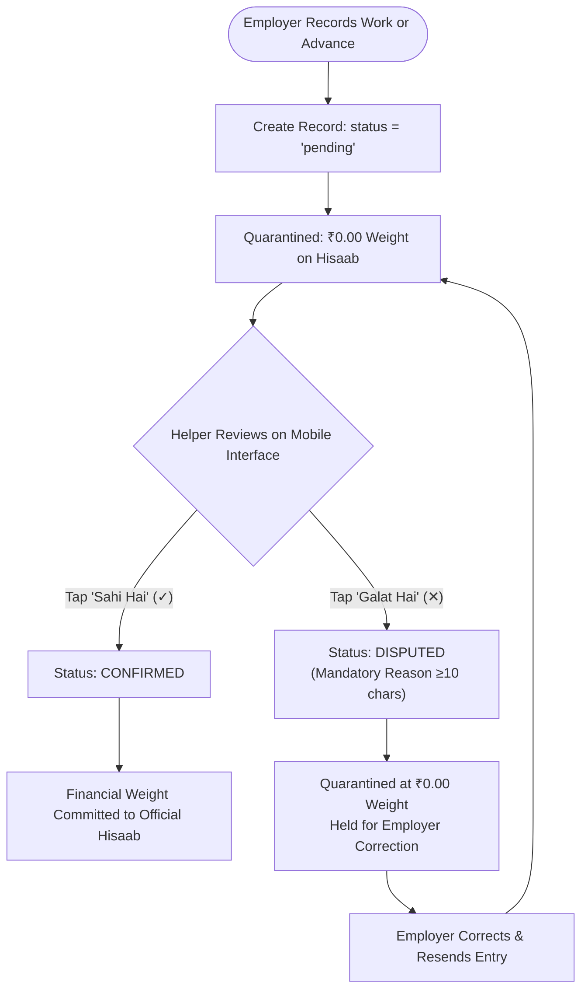
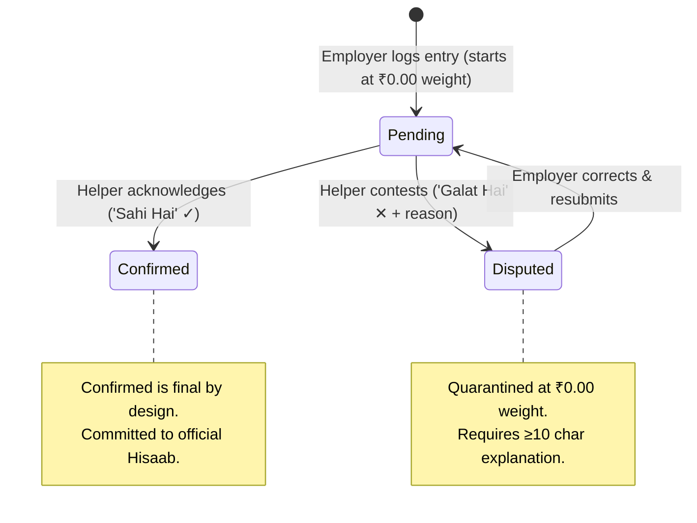
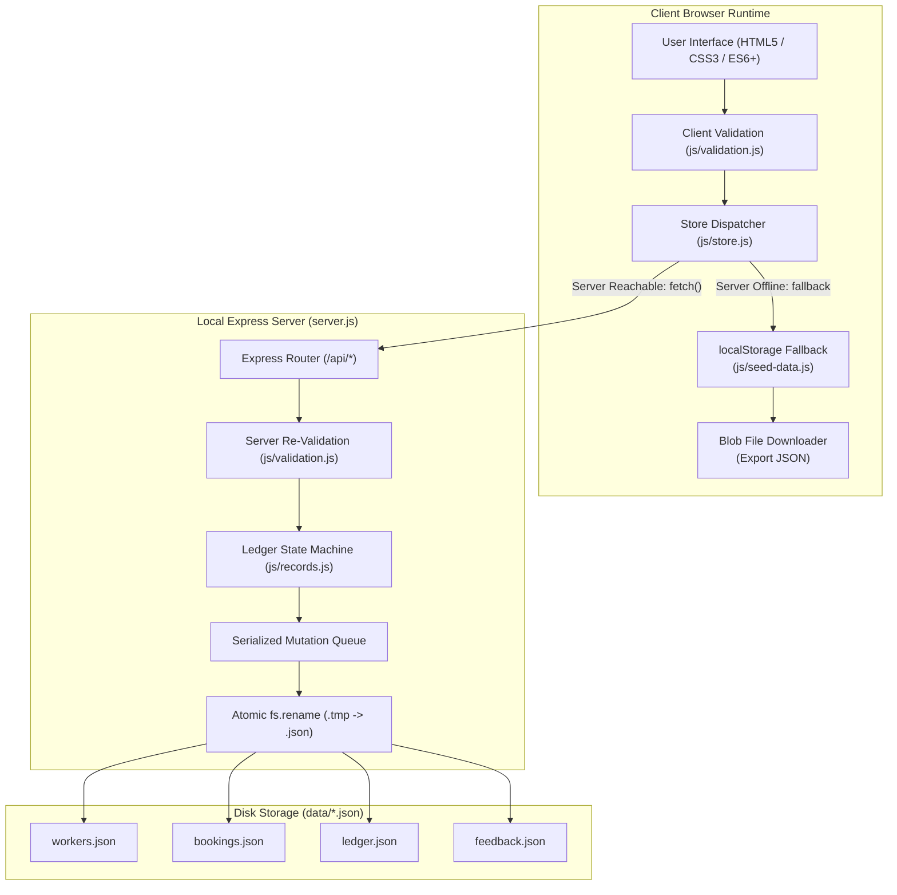

<p align="center">
  
</p>

<h1 align="center">SevaKhata (सेवाखाता)</h1>

<p align="center">
  <strong>"Dono ka record, ek hi hisaab."</strong><br>
  <em>Jo dono maane, wahi hisaab.</em>
</p>

<p align="center">
  A bilingual, two-sided shared work-and-payment ledger engineered for domestic employment.<br>
  Establishing a single, mutually verified source of truth between households and domestic helpers.
</p>

<p align="center">
  <a href="./package.json"></a>
  <a href="https://nodejs.org/"></a>
  <a href="https://expressjs.com/"></a>
  <a href="./package.json"></a>
  
  
  <a href="./scripts/smoke-test.js"></a>
  <a href="./design/figma-svgs/"></a>
</p>

<p align="center">
  <a href="#quick-start--evaluation-guide">Quick Start</a> •
  <a href="#project-overview">Project Overview</a> •
  <a href="#the-problem">The Problem</a> •
  <a href="#the-consensus-solution">The Solution</a> •
  <a href="#how-it-works">How It Works</a> •
  <a href="#shared-hisaab-calculation">Hisaab Logic</a> •
  <a href="#multi-page-workflows">Workflows</a> •
  <a href="#technology-stack">Tech Stack</a> •
  <a href="#system-architecture">Architecture</a> •
  <a href="#api-specification">API Spec</a> •
  <a href="#current-implementation-status">Status & Roadmap</a>
</p>

---

<a id="quick-start--evaluation-guide"></a>
## Quick Start & Evaluation Guide

SevaKhata operates in two runtime modes: a **live server mode** saving submissions directly to atomic local JSON files, and an **offline client mode** running with zero server dependencies using browser `localStorage` and client-side JSON export.

### 1. Run Options

#### Option A: Live Server Mode (Recommended — Node.js 18+)

```bash
# Install dependencies (Express 4.21.2)
npm install

# Start the local server on http://localhost:3000
npm start
```

*Submissions are validated and appended to [`data/workers.json`](./data/workers.json), [`data/bookings.json`](./data/bookings.json), [`data/ledger.json`](./data/ledger.json), and [`data/feedback.json`](./data/feedback.json). The header badge dynamically reports `Live server · saving to data/*.json`.*

To execute on a custom port:
```bash
PORT=4000 npm start
```

#### Option B: Offline Demo Mode (Zero Server Dependencies)

Open [`index.html`](./index.html) directly in any modern browser or run with any static file server:
```bash
python3 -m http.server 8000
```
- The application automatically detects that no backend API is reachable and switches to **offline demo mode** (header badge: `Offline demo · saving in this browser`).
- Data is seeded from [`js/seed-data.js`](./js/seed-data.js) into `localStorage`.
- Every page provides an **Export JSON** control that downloads the updated state as a standalone `.json` Blob.

### 2. Verification & Maintenance Commands

```bash
npm test              # Run zero-dependency smoke test (validation schemas, ledger math, and API routes)
npm run sync-seed     # Re-synchronize js/seed-data.js after manually editing data/*.json
git checkout -- data/ # Restore original clean evaluation records after a live demo session
```

### 3. Evaluation Parameter Implementation Checklist

| # | Parameter | Source Files | Implemented Capability |
| :-- | :--- | :--- | :--- |
| **1** | **Multi-Page Workflows & Complete Linking** | [`index.html`](./index.html), [`ledger.html`](./ledger.html), [`directory.html`](./directory.html), [`register-worker.html`](./register-worker.html), [`hire-household.html`](./hire-household.html), [`contact-feedback.html`](./contact-feedback.html), [`login.html`](./login.html), [`pages.css`](./pages.css), [`login.css`](./login.css) | Seven dedicated pages sharing responsive navigation (with mobile hamburger drawer), consistent footers, active-page visual state, and **zero broken `#` placeholder links**. Cross-linked state transitions (e.g., directory profile links directly to pre-filled hire form: `hire-household.html?worker=w-1001`, and all navigation bars include direct access to the floating authentication folio). |
| **2** | **Validation, Interactions & Bilingual UX** | [`js/validation.js`](./js/validation.js), [`js/ui.js`](./js/ui.js), [`js/i18n.js`](./js/i18n.js), [`js/pages/`](./js/pages/) | Real-time inline field validation on `input`/`blur` (red/green states without native browser alert popups). Regex enforcement for Indian mobile numbers (`^[6-9]\d{9}$`), email formats, Aadhaar/PAN validation, and positive wages. Live search/filtering in directory and ledger. Persistent **EN ⇄ हिं** toggle translating both static text and dynamic validation messages across page reloads. |
| **3** | **Asynchronous Form Submissions** | [`js/pages/*.js`](./js/pages/), [`js/ui.js`](./js/ui.js) (`bindForm`), [`js/store.js`](./js/store.js) | Form submissions intercepted via `e.preventDefault()`, executed through `fetch()` with `async/await`. Visual loading states with button spinners, animated confirmation modals returning unique reference IDs (`w-...`, `b-...`, `l-...`, `f-...`), and immediate in-memory UI updates without full page reload. |
| **4** | **Data Persistence in Local JSON Files** | [`server.js`](./server.js), [`data/*.json`](./data/), [`js/store.js`](./js/store.js), [`js/seed-data.js`](./js/seed-data.js) | Express endpoints (`/api/workers`, `/api/bookings`, `/api/ledger`, `/api/feedback`) performing serialized, atomic writes to disk (`.tmp` write followed by `fs.rename`). Offline mode transparently falls back to `localStorage` with client-side JSON file downloads. |

### 4. Suggested 3-Minute Viva Demonstration

1. **Onboarding & Validation ([`register-worker.html`](./register-worker.html)):** Trigger an empty submit to showcase instant inline error states. Enter invalid phone and Aadhaar values to demonstrate regex validation. Complete a valid registration, submit, and observe the new record appended directly to `data/workers.json` (with Aadhaar stored as `idLast4` only).
2. **Directory Search & Pre-filled Handoff ([`directory.html`](./directory.html)):** Search for "cook", toggle the *Verified only* filter, inspect the transparent 0–100 Trust Score breakdown, and click *Hire*. The application transitions to `hire-household.html?worker=w-1001` with the helper's details pre-populated.
3. **Ledger as Employer ([`ledger.html`](./ledger.html)):** With the role selector set to *View as Employer*, log a new daily attendance entry (₹500). Observe that the row appears tagged as **Pending** in amber, and the confirmed net balance does **not** change.
4. **Bilateral Review as Helper ([`ledger.html`](./ledger.html)):** Switch the role selector to *View as Helper*. Click **Confirm (*Sahi Hai*)** on the pending entry: the badge transitions to emerald and the confirmed balance increases by ₹500. Click **Dispute (*Galat Hai*)** on another entry, enter a reason (e.g., "Amount was ₹300, not ₹500"), and verify that the entry remains excluded from the confirmed balance.
5. **Correction & Resubmission as Employer:** Switch back to *View as Employer*. Click *Correct & resend* on the disputed entry, modify the amount, and resubmit. The entry returns to the **Pending** state awaiting helper re-verification.
6. **Bilingual Toggle & Export:** Toggle the **EN ⇄ हिं** switch in the navigation bar to demonstrate full Devanagari translation, then click **Export JSON** to verify client-side data serialization.

---

<a id="project-overview"></a>
## Project Overview

Domestic employment in urban and semi-urban India represents one of the largest informal labor sectors, employing millions of domestic helpers, cooks, cleaners, nannies, caregivers, and drivers. 

This sector operates almost entirely without written employment contracts, formal digital bookkeeping, or synchronized records.

```
       EMPLOYER PERSPECTIVE                              HELPER PERSPECTIVE
 ┌──────────────────────────────┐                  ┌──────────────────────────────┐
 │  Kitchen Wall Calendar       │                  │  Mental Ledger / Memory      │
 │  • Pencil tick marks         │   DISCREPANCIES  │  • Unrecorded cash handovers │
 │  • Ambiguous half-days       │ ◄──────────────► │  • Lost advance tallies      │
 │  • Personal smartphone notes │   AT MONTH END   │  • Unclear substitute days   │
 └──────────────────────────────┘                  └──────────────────────────────┘
                                        │
                                        ▼
                        FRICTION, AWKWARD NEGOTIATIONS,
                          EROSION OF MUTUAL RESPECT
```

### The Defining Philosophy

The name **SevaKhata** unites two foundational cultural concepts:
- **Seva (सेवा):** Domestic assistance, household service, care, and mutual respect.
- **Khata (खाता):** The traditional Indian ledger (*bahi-khata*), accounting register, and shared financial record.

The product's identity is defined by its core axiom:

> **"Dono ka record, ek hi hisaab."**  
> *Jo dono maane, wahi hisaab.*  
> *(What both acknowledge becomes the single official truth.)*

Unlike unilateral tracking applications that treat workers merely as entries to be managed, SevaKhata is a **two-sided, bilateral consensus ledger**. The domestic helper is an equal participant with independent authority to review, verify, or contest every single record.

---

<a id="the-problem"></a>
## The Problem

| Traditional Practice | Structural Failure Mode | Human & Relationship Cost |
| :--- | :--- | :--- |
| **Wall Calendar Tick Marks** | Pencil marks cannot distinguish between full-days, half-days, extra chores, or substitute staff. Marks smudge, fade, or are lost. | Ambiguity on the 1st of every month regarding exact days worked versus missed. |
| **Doorway Cash Advances (*Pesgi*)** | Cash handovers occur hurriedly at the doorway during morning departures without timestamps or receipts. | Recall divergence by month-end: disputes over whether an advance was ₹500 or ₹1,000. |
| **Unilateral Smartphone Notes** | Entries are stored solely on the employer's device, entirely invisible to the helper until settlement day. | The helper feels excluded from their own earning records; lack of transparency breeds suspicion. |
| **Memory & Unwritten Recall** | Relying on human memory across a 30-day billing cycle inevitably produces cognitive bias and recall errors. | Loss of dignity, awkward arguments, and emotional stress during month-end payment settlement. |

**The Root Technical Cause:** The absence of a shared, concurrent state between the two participating stakeholders.

---

<a id="the-consensus-solution"></a>
## The Consensus Solution

SevaKhata enforces an **asymmetric recording and symmetric acknowledgement** workflow. Either party can initiate transparency, but neither can unilaterally commit a financial change:

1. **Recording Phase:** The employer records daily attendance, special tasks, cash advances (*pesgi*), or payments.
2. **Quarantine Invariant:** The new entry is strictly quarantined in a `PENDING` state with **₹0.00 weight** on the running payable balance.
3. **Verification Phase:** The helper reviews the entry in clear Hindi (Devanagari) on their mobile interface.
4. **Resolution Phase:**
   - **Confirm (*Sahi Hai · सही है*):** The entry transitions to `CONFIRMED`. Its value is released from quarantine and incorporated into the official *Hisaab*.
   - **Dispute (*Galat Hai · गलत है*):** The entry transitions to `DISPUTED` with a mandatory reason. It remains quarantined at ₹0.00 weight until reconciled.



---

<a id="how-it-works"></a>
## How It Works

### The Consensus State Machine

A ledger entry exists in exactly one of three operational states. Transitions are strictly governed by caller role and current state:



### Operational State Specifications

| State | Balance Weight | Visual Treatment | Operational Rules |
| :--- | :--- | :--- | :--- |
| **`PENDING`** | **₹0.00 (Quarantined)** | Amber Badge / Warning Reticle | Newly logged entry awaiting review. Completely excluded from the official balance to prevent unverified liabilities. |
| **`CONFIRMED`** | **Active Value (`±₹Amount`)** | Emerald Badge / Dual Checkmark | Mutually verified entry. Value is permanently committed to the shared running balance. **Confirmed is final by design.** |
| **`DISPUTED`** | **₹0.00 (Quarantined)** | Rose Badge / Alert Reticle | Contested entry with a mandatory explanation. Held off the official balance. Can be corrected and resent only by the employer. |

---

<a id="shared-hisaab-calculation"></a>
## Shared Hisaab Calculation

The running payable balance (*Official Hisaab*) is derived exclusively from mutually acknowledged records. Unverified or contested entries hold zero weight:

$$\text{Official Hisaab} = \sum \text{Confirmed Earnings} + \sum \text{Confirmed Bonuses} \pm \sum \text{Confirmed Adjustments} - \sum \text{Confirmed Payments} - \sum \text{Confirmed Advances}$$

$$\text{Pending Entries} \times 0.00 + \text{Disputed Entries} \times 0.00 = 0.00$$

### Financial Record Polarity

| Record Type (`type`) | Financial Polarity | Domain Description | Example Entry |
| :--- | :--- | :--- | :--- |
| **`attendance`** | Credit (`+₹`) | Standard full-day, half-day, or extra household work | 8 Full Days Housework $= +₹4,000$ |
| **`bonus`** | Credit (`+₹`) | Festival bonuses (Diwali, Eid), deep cleaning, special catering | Raksha Bandhan Bonus $= +₹1,000$ |
| **`adjustment`** | Signed (`±₹`) | Reconciled corrections mutually agreed upon | Rate differential adjustment $= \pm₹200$ |
| **`payment`** | Debit (`−₹`) | Formal mid-month salary payments or bank transfers | Mid-month partial cash payment $= -₹6,000$ |
| **`advance`** | Debit (`−₹`) | Early cash handovers (*pesgi*) for family, medical, or school expenses | School fee advance $= -₹1,000$ |

### Concrete Demonstration Scenario

The interactive prototype demonstrates this logic using the baseline scenario for **Sharma Household × Sunita Sharma (August 2026)**:

```
1. Historical Confirmed Work:    8 Full Days Housework & Cooking       =  +₹4,000  (CONFIRMED)
2. Historical Confirmed Advance: 05 Aug School Fee Advance (Pesgi)    =  -₹1,000  (CONFIRMED)
─────────────────────────────────────────────────────────────────────────────────────────────
   BASELINE CONFIRMED BALANCE:                                         =   ₹3,000

3. Active Today Entry (13 Aug):  Full Day Housework & Cooking          =  +₹500
   • Initial State (PENDING):    Weight = ₹0.00  ──▶  Running Balance  =   ₹3,000
   • Helper taps 'Sahi Hai':     Weight = +₹500  ──▶  Running Balance  =   ₹3,500
   • Helper taps 'Galat Hai':    Weight = ₹0.00  ──▶  Running Balance  =   ₹3,000
```

---

<a id="product-roles"></a>
## Product Roles & Responsibilities

```
┌──────────────────────────────────────────────┬──────────────────────────────────────────────┐
│                EMPLOYER ROLE                 │                 HELPER ROLE                  │
├──────────────────────────────────────────────┼──────────────────────────────────────────────┤
│ • Set up monthly household folio             │ • Access mobile ledger in Hindi (Devanagari) │
│ • Log daily attendance & half-days           │ • Review pending entries recorded by employer│
│ • Record cash advances (pesgi) at handover   │ • Tap 'Sahi Hai' to confirm valid records    │
│ • Record mid-month and month-end payments    │ • Tap 'Galat Hai' with reason for errors     │
│ • Review helper dispute explanations         │ • Inspect running confirmed net balance      │
│ • Correct and resend disputed records        │ • Review historical monthly payment receipts │
│ • View audit history of all verifications    │ • Request profile verification & support     │
└──────────────────────────────────────────────┴──────────────────────────────────────────────┘
```

> [!NOTE]
> **Authentication Scope Disclosure:** In the current Evaluation 2 release, the "View as Employer / Helper" switcher and the API `actor` parameter are demonstration controls designed for interactive evaluation. Production multi-tenant authentication with mobile OTP is scheduled for Phase 1 of the backend roadmap.

---

<a id="bilingual-experience"></a>
## Bilingual Experience & Cultural Typography

SevaKhata integrates Hindi (Devanagari) as an **intrinsic, first-class design system foundation**, not as an auxiliary translation.

### Domain Vocabulary Lockups

| Concept | English Term | Authentic Hindi / Devanagari | Cultural & Operational Meaning |
| :--- | :--- | :--- | :--- |
| **Service & Account** | SevaKhata | सेवाखाता (*SevaKhata*) | Mutual household work register and accounting folio |
| **Shared Balance** | Net Hisaab | साझा हिसाब (*Sajha Hisaab*) | Mutually acknowledged running balance owed |
| **Cash Advance** | Cash Advance | अग्रिम / पेसगी (*Pesgi*) | Mid-month cash handovers for family or emergency needs |
| **Work Attendance** | Attendance | हाज़िरी (*Haaziri*) | Daily household labor, cooking, cleaning, or childcare |
| **Payment** | Payment | भुगतान (*Bhugtan*) | Formal wage transfers or cash settlement |
| **Confirmation** | Confirm | सही है (*Sahi Hai*) | Worker verification: entry released into official balance |
| **Dispute** | Dispute | गलत है (*Galat Hai*) | Worker contestation: quarantined at ₹0.00 balance weight |
| **Pending State** | Pending | लंबित (*Lambit*) | Awaiting mutual acknowledgement (₹0.00 weight) |
| **Confirmed State** | Confirmed | पुष्टि की गई (*Pushti Ki Gayi*) | Mutually locked and committed balance entry |

### Typography Hierarchy & Type Stack

```
Bebas Neue               MONUMENTAL NUMERALS & KICKERS (₹3,000, SEVAKHATA)
Inter                    System UI, Navigation, Gridded Ledger Cells, Metadata
Noto Sans Devanagari     Primary Hindi UI Actions (सही है, गलत है, पेसगी, विवरण)
Tiro Devanagari Hindi    Traditional Hindi Cultural Axioms ("जो दोनों मानें, वही हिसाब")
```

---

<a id="multi-page-workflows"></a>
## Multi-Page Workflows

SevaKhata comprises six cohesive, inter-linked application pages built with vanilla semantic technologies:

```
                                  ┌────────────────────────┐
                                  │   index.html (Home)    │
                                  │   • Hero narrative     │
                                  │   • Interactive slab   │
                                  │   • Consensus stepper  │
                                  └───────────┬────────────┘
                                              │
         ┌──────────────────┬─────────────────┼──────────────────┬──────────────────┐
         ▼                  ▼                 ▼                  ▼                  ▼
┌──────────────────┐┌────────────────┐┌────────────────┐┌─────────────────┐┌─────────────────┐
│   ledger.html    ││ directory.html ││register-worker ││hire-household   ││contact-feedback │
│• Employer/Helper ││• Search/filter ││• Helper intake ││• Household jobs ││• Support tickets │
│  view switcher   ││• Trust Score   ││• Skill tags    ││• Pre-filled     ││• Dispute claims  │
│• Confirm/Dispute ││• Direct hire   ││• Aadhaar last-4│  helper links    │• Verification    │
│• Live Hisaab math│  profile links  │  sanitization   │• Schedule & rate │  inquiries       │
└──────────────────┘└────────────────┘└────────────────┘└─────────────────┘└─────────────────┘
```

### Detailed Workflow Matrix

| Page | Route / File | Key Features & Interactions | Persistence Mapping |
| :--- | :--- | :--- | :--- |
| **Home / Landing** | [`index.html`](./index.html) | Editorial narrative in 5 movements; interactive living khata slab; cubic ease-out counter ticker (₹3,000 $\leftrightarrow$ ₹3,500); 3-stage consensus stepper; spatial memory parallax. | In-memory demonstration state |
| **Shared Ledger** | [`ledger.html`](./ledger.html) | View as Employer / View as Helper toggle; live Hisaab balance summary; record daily attendance, advances, payments, and bonuses; inline Confirm, Dispute (with reason modal), and Resubmit actions. | `GET/POST /api/ledger`<br>`PATCH /api/ledger/:id`<br>[`data/ledger.json`](./data/ledger.json) |
| **Helper Directory** | [`directory.html`](./directory.html) | Live search across helper names, skills, and locations; category filter pills; *Verified only* toggle; transparent 0–100 Trust Score breakdown cards; direct *Hire* action linking to booking form. | `GET /api/workers`<br>[`data/workers.json`](./data/workers.json) |
| **Worker Onboarding** | [`register-worker.html`](./register-worker.html) | Multi-step helper registration; category picker; dynamic skill tags; wage type selection; real-time Aadhaar/PAN regex validation (stores only last 4 characters); success modal with ID. | `POST /api/workers`<br>[`data/workers.json`](./data/workers.json) |
| **Household Booking** | [`hire-household.html`](./hire-household.html) | Request household services; supports new general requests or targeted bookings (`?worker=w-1001`); schedule specifications; offered budget validation; auto-populates worker details. | `POST /api/bookings`<br>[`data/bookings.json`](./data/bookings.json) |
| **Support & Feedback** | [`contact-feedback.html`](./contact-feedback.html) | Inquiries across support, disputes, profile verification, and general feedback; star rating selector; character count validation; generates trackable ticket reference ID. | `POST /api/feedback`<br>[`data/feedback.json`](./data/feedback.json) |
| **Authentication Folio** | [`login.html`](./login.html) | Floating Apple-grade translucent folio with interactive 3D perspective tilt physics; Email & Password mode with show/hide toggle; Mobile OTP tab with 6-digit auto-advancing input; complete bilingual validation & session state. | Prototype Session / Auth Gateway |

### Transparent Trust Score Calculation

The directory features a mathematical 0–100 Trust Score implemented in [`js/records.js`](./js/records.js):

$$\text{Trust Score} = \text{ID Check (30)} + \text{Rating (30)} + \text{Experience (10)} + \text{Record Reliability (30)}$$

- **ID Check:** 30 points if government ID format is verified.
- **Rating:** Scaled up to 30 points based on 5-star rating $\left(\frac{\text{Rating}}{5} \times 30\right)$.
- **Experience:** 1 point per year, capped at 10 years (10 points).
- **Record Reliability:** Ratio of confirmed vs total reviewed records $\left(\frac{\text{Confirmed}}{\text{Reviewed}} \times 30\right)$. For new helpers with 0 reviewed entries, a neutral baseline of 15 points is assigned to prevent penalizing newcomers.

---

<a id="technology-stack"></a>
## Technology Stack

<p align="center">
  
</p>

The SevaKhata architecture leverages clean, standards-compliant web technologies with minimal runtime overhead:

```
┌─────────────────────────────────────────────────────────────────────────────────────────────┐
│                                       FRONTEND LAYER                                        │
│  Semantic HTML5       Vanilla CSS3 Tokens      Vanilla ES6+ Modules       Google Fonts CDN  │
│  (ARIA Landmarks)     (CSS Grid & Variables)   (UMD Shared Logic)         (4 Type Families) │
└──────────────────────────────────────────────┬──────────────────────────────────────────────┘
                                               │
                                 HTTP / REST   │   Fallback Mode
                                 Fetch API     │   (No Server)
                                               ▼
┌─────────────────────────────────────────────────────────────────────────────────────────────┐
│                                BACKEND & PERSISTENCE LAYER                                  │
│  Node.js (>= 18)     Express 4.21.2 API       Atomic JSON Files          Browser Storage    │
│  Runtime Environment REST Endpoints           (data/*.json via fs)       (localStorage)     │
└─────────────────────────────────────────────────────────────────────────────────────────────┘
```

### Verified Implementation Stack

| Category | Technology | Version / Spec | Badge | Purpose in Project |
| :--- | :--- | :--- | :--- | :--- |
| **Frontend Markup** | HTML5 | Living Standard |  | Semantic document outline (`<header>`, `<main>`, `<nav>`, `<article>`, `<section>`, `<footer>`), ARIA live regions and accessibility labels. |
| **Frontend Styling** | CSS3 | Custom Properties |  | Atomic design token architecture in [`style.css`](./style.css) and [`pages.css`](./pages.css), strict 4-column CSS Grid ledger layout, fluid clamp typography, zero CSS frameworks. |
| **Frontend Logic** | JavaScript | ECMAScript 2020+ |  | Vanilla client-side modules, DOM event delegation, `requestAnimationFrame` cubic ease-out counter ticker, inline form binder, UMD modularity. |
| **Backend Runtime** | Node.js | `>= 18.0.0` |  | Server runtime executing [`server.js`](./server.js), custom test runner, and seed synchronizer. |
| **Web Framework** | Express.js | `^4.21.2` |  | Minimalist HTTP server serving static assets, CORS negotiation, and RESTful JSON endpoints. |
| **Persistence (Live)** | File System (JSON) | Node.js `fs.promises` |  | Serialized queue-based atomic write system (`.tmp` write + `fs.rename`) into [`data/*.json`](./data/). |
| **Persistence (Offline)** | Web Storage API | `localStorage` + `Blob` |  | Automatic fallback persistence when server is absent; dynamic client-side JSON export download. |
| **Quality Assurance** | Node.js Test Harness | Built-in `assert` |  | Zero-dependency automated test runner in [`scripts/smoke-test.js`](./scripts/smoke-test.js). |
| **Design Specification** | Figma Vector Suite | SVG 1.1 Standard |  | 7 component-structured, native text vector artboards in [`design/figma-svgs/`](./design/figma-svgs/). |
| **API Tooling** | Built-in Test Runner | Zero Dependency |  | Automated verification suite in [`scripts/smoke-test.js`](./scripts/smoke-test.js). |

---

<a id="system-architecture"></a>
## System Architecture & Data Flow

### Dual-Runtime Operational Architecture



### Shared Code Philosophy (UMD Modules)

To prevent discrepancies between client validation and server enforcement, core domain logic is written as Universal Module Definition (UMD) scripts that run natively in both environments:
- **[`js/validation.js`](./js/validation.js):** Contains canonical validation schemas for workers, bookings, ledger entries, dispute notes, and feedback.
- **[`js/records.js`](./js/records.js):** Encapsulates the state machine (`applyLedgerAction`), sanitization rules (`clean`), the canonical balance equation (`balance`), and the transparent trust score algorithm (`trustScore`).

---

<a id="api-specification"></a>
## API Specification

The Express server in [`server.js`](./server.js) exposes a clean REST API persisting to flat JSON files.

### Endpoint Overview

| Method | Endpoint | Description | Status Code |
| :--- | :--- | :--- | :--- |
| `GET` | `/api/health` | Health status and available resources | `200 OK` |
| `GET` | `/api/workers` | List all registered domestic helpers | `200 OK` |
| `POST` | `/api/workers` | Register a new helper profile (stores `idLast4` only) | `201 Created` / `400 Bad Request` |
| `GET` | `/api/bookings` | List all household booking requests | `200 OK` |
| `POST` | `/api/bookings` | Submit a household booking request | `201 Created` / `400 Bad Request` |
| `GET` | `/api/ledger` | Retrieve all ledger records | `200 OK` |
| `POST` | `/api/ledger` | Create a new ledger entry (always starts `pending`) | `201 Created` / `400 Bad Request` |
| `PATCH` | `/api/ledger/:id` | Perform helper action (confirm/dispute) or employer resubmit | `200 OK` / `400` / `403` / `409` |
| `GET` | `/api/feedback` | List all contact/support tickets | `200 OK` |
| `POST` | `/api/feedback` | Submit a feedback or support request | `201 Created` / `400 Bad Request` |

### Key Request & Response Examples

<details>
<summary><strong>1. Create Ledger Entry: <code>POST /api/ledger</code></strong></summary>

**Request Body:**
```json
{
  "workerId": "w-1001",
  "householdName": "Sharma Household",
  "type": "attendance",
  "attendanceKind": "full",
  "days": 1,
  "date": "2026-08-15",
  "amount": 500,
  "note": "Independence Day special cooking"
}
```

**Response (`201 Created`):**
```json
{
  "id": "l-2009",
  "workerId": "w-1001",
  "workerName": "Sunita Sharma",
  "householdName": "Sharma Household",
  "type": "attendance",
  "attendanceKind": "full",
  "days": 1,
  "date": "2026-08-15",
  "amount": 500,
  "note": "Independence Day special cooking",
  "status": "pending",
  "createdBy": "employer",
  "disputeReason": "",
  "createdAt": "2026-08-15T18:00:00.000Z"
}
```
*Note: Any client-supplied `status` field is strictly overridden to `pending` by server logic.*
</details>

<details>
<summary><strong>2. Confirm Entry: <code>PATCH /api/ledger/:id</code></strong></summary>

**Request Body:**
```json
{
  "action": "confirm",
  "actor": "helper"
}
```

**Response (`200 OK`):**
```json
{
  "id": "l-2009",
  "status": "confirmed",
  "confirmedAt": "2026-08-15T19:30:00.000Z",
  "disputeReason": ""
}
```
*Calling confirm with `actor: "employer"` returns `403 Forbidden`.*
</details>

<details>
<summary><strong>3. Dispute Entry: <code>PATCH /api/ledger/:id</code></strong></summary>

**Request Body:**
```json
{
  "action": "dispute",
  "actor": "helper",
  "reason": "I worked a full day, but the amount is logged as half-day."
}
```

**Response (`200 OK`):**
```json
{
  "id": "l-2009",
  "status": "disputed",
  "disputedAt": "2026-08-15T19:35:00.000Z",
  "disputeReason": "I worked a full day, but the amount is logged as half-day."
}
```
*Dispute requests without a reason or with a reason shorter than 10 characters return `400 Bad Request`.*
</details>

<details>
<summary><strong>4. Employer Resubmit Entry: <code>PATCH /api/ledger/:id</code></strong></summary>

**Request Body:**
```json
{
  "action": "resubmit",
  "actor": "employer",
  "amount": 500,
  "note": "Corrected to full day rate"
}
```

**Response (`200 OK`):**
```json
{
  "id": "l-2009",
  "status": "pending",
  "amount": 500,
  "note": "Corrected to full day rate",
  "resubmittedAt": "2026-08-15T20:00:00.000Z",
  "history": [
    {
      "status": "disputed",
      "reason": "I worked a full day, but the amount is logged as half-day.",
      "amount": 250,
      "at": "2026-08-15T19:35:00.000Z"
    }
  ]
}
```
*Resubmission resets status to `pending`, clears current `disputeReason`, and appends the prior dispute to `history`.*
</details>

<details>
<summary><strong>5. Register Helper: <code>POST /api/workers</code></strong></summary>

**Request Body:**
```json
{
  "name": "Pooja Verma",
  "phone": "9812345678",
  "category": "maid",
  "skills": "Cleaning, Dusting, Laundry",
  "experienceYears": 4,
  "location": "Indirapuram, Ghaziabad",
  "rateType": "monthly",
  "rate": 4500,
  "idType": "aadhaar",
  "idNumber": "234567894821"
}
```

**Response (`201 Created`):**
```json
{
  "id": "w-1005",
  "name": "Pooja Verma",
  "phone": "9812345678",
  "category": "maid",
  "skills": ["Cleaning", "Dusting", "Laundry"],
  "experienceYears": 4,
  "location": "Indirapuram, Ghaziabad",
  "rateType": "monthly",
  "rate": 4500,
  "idType": "aadhaar",
  "idLast4": "4821",
  "verified": false,
  "rating": null,
  "reviews": 0,
  "createdAt": "2026-08-23T11:00:00.000Z"
}
```
*Privacy Invariant: The full `idNumber` is validated in memory and discarded; only `idLast4` is preserved.*
</details>

---

<a id="repository-structure"></a>
## Repository Structure

```
SevaKhata/
├── assets/
│   └── brand/                         # Vector brand assets and seals
│       ├── favicon.svg                # Browser tab favicon
│       ├── sevakhata-mark.svg         # Primary brand mark (converging folios & emerald seal)
│       └── sevakhata-seal-stamp.svg   # Circular rotating mutual agreement seal
├── data/                              # Atomic JSON database written by server.js
│   ├── bookings.json                  # Household service requests
│   ├── feedback.json                  # Support tickets, disputes, and reviews
│   ├── ledger.json                    # Attendance, advance, and payment records
│   └── workers.json                   # Registered helper profiles and trust scores
├── design/                            # Figma vector suite & design specifications
│   ├── figma-svgs/                    # 100% editable Figma-compatible vector artboards
│   │   ├── 01-home-index.svg          # Desktop master landing artboard
│   │   ├── 02-ledger-records.svg      # Shared ledger folio view
│   │   ├── 03-worker-directory-store.svg # Searchable helper directory
│   │   ├── 04-register-worker.svg     # Worker onboarding intake
│   │   ├── 05-hire-household.svg      # Household hiring request
│   │   ├── 06-contact-feedback.svg    # Support ticket and dispute form
│   │   ├── 07-components-and-popups.svg # UI stickersheet, modals, and toasts
│   │   └── 08-login-desktop-1440.svg  # 100% editable Figma login artboard
├── js/                                # Vanilla modular JavaScript engine
│   ├── pages/                         # Page-specific controller scripts
│   │   ├── contact-feedback.js        # Support form handling & rating interaction
│   │   ├── directory.js               # Helper search, filtering, and trust score rendering
│   │   ├── hire-household.js          # Booking submission & pre-filled worker logic
│   │   ├── ledger.js                  # Ledger folio, role toggle, confirm/dispute modals
│   │   ├── login.js                   # 3D perspective physics, OTP auto-advance & tab interactions
│   │   └── register-worker.js         # Worker registration & validation handling
│   ├── i18n.js                        # English/Hindi translation dictionary & toggle engine
│   ├── records.js                     # Shared UMD state machine, Hisaab math & trust scoring
│   ├── seed-data.js                   # Client-side seed fallback for offline demo mode
│   ├── site.js                        # Navigation and language bindings for index.html
│   ├── store.js                       # Asynchronous fetch client, localStorage fallback & JSON export
│   ├── ui.js                          # Toast notifications, modal dialogs, and inline form binder
│   └── validation.js                  # Shared canonical validation schemas (browser + server)
├── scripts/                           # Maintenance and verification utilities
│   ├── smoke-test.js                  # Automated zero-dependency test runner (npm test)
│   └── sync-seed.js                   # Synchronizes js/seed-data.js from data/*.json
├── contact-feedback.html              # Support inquiries & dispute reporting page
├── directory.html                     # Helper directory with trust score breakdown
├── hire-household.html                # Household booking request page
├── index.html                         # Editorial landing page & living khata prototype
├── ledger.html                        # Bilateral digital ledger page
├── login.html                         # Floating Apple-grade authentication folio
├── login.css                          # Apple Liquid Glass styling, specular highlights & tilt styles
├── register-worker.html               # Domestic worker registration page
├── main.js                            # Landing page scroll choreography & ease-out ticker
├── pages.css                          # Shared styles for inner workflow pages
├── style.css                          # Master stylesheet, design tokens, and landing styles
├── package.json                       # Project metadata, scripts, and dependencies
├── package-lock.json                  # Pinned dependency lockfile
├── server.js                          # Express HTTP server & atomic JSON API
└── README.md                          # Project documentation
```

---

<a id="getting-started"></a>
## Getting Started

### Prerequisites

- **Node.js:** Version `18.0.0` or higher (recommended for live JSON API mode).
- **Web Browser:** Any modern evergreen browser (Chrome, Edge, Safari, Firefox).

### Installation & Execution

```bash
# Clone the repository
git clone https://github.com/darshsharma-bit/SevaKhata.git
cd SevaKhata

# Install dependencies (Express 4.21.2)
npm install

# Start the application server
npm start
```

Open your browser and navigate to:
```
http://localhost:3000
```

### Alternative Local Servers

If you prefer to run the frontend without Node.js, you can use Python's built-in HTTP server:
```bash
python3 -m http.server 8000
```
Navigate to `http://localhost:8000`. The application will operate in offline demo mode using browser storage.

---

<a id="testing--quality-assurance"></a>
## Testing & Quality Assurance

The repository includes a custom, zero-dependency test suite in [`scripts/smoke-test.js`](./scripts/smoke-test.js) that validates business invariants, validation schemas, and API behaviors.

Execute the test suite:
```bash
npm test
```

### Verification Suite Coverage

```
Validation Rules
  ✓ Indian phone numbers (10 digits starting with 6-9)
  ✓ ID formats by type (Aadhaar 12-digit algorithm, PAN alphanumeric)
  ✓ Wage amounts (positive numbers within realistic bounds)

Ledger Rules
  ✓ Only CONFIRMED entries reach the balance (quarantine invariant)
  ✓ State machine: Pending -> Confirm / Dispute (Confirmed is final)
  ✓ Employer cannot confirm entries on behalf of helper (role boundary)
  ✓ Dispute requires meaningful explanation (≥10 characters)

API Integration (Isolated Temporary Data Copy)
  ✓ GET returns seeded records
  ✓ Invalid POST payloads rejected with field-specific errors
  ✓ Valid worker appended to workers.json (ID stored as last 4 only)
  ✓ New ledger entry always starts pending (client status override rejected)
  ✓ Feedback and booking submissions persist accurately
  ✓ Static security: server source and data directories blocked from browser access
```

---

<a id="responsive-design--accessibility"></a>
## Responsive Design & Accessibility

### Accessibility Implementations

- **Semantic Landmark Outline:** Structured `<header role="banner">`, `<nav aria-label="Primary Navigation">`, `<main id="mainCanvas">`, `<article>`, and `<footer role="contentinfo">`.
- **Live Status Announcements:** Navigation telemetry and balance updates use `role="status"` and `aria-live="polite"`.
- **Touch Ergonomics:** All interactive buttons, inputs, and toggles on mobile viewports adhere to a minimum touch target height of **48px**.
- **Assistive Technology Protection:** Decorative vector seals, ambient grid reticles, and indicator dots are declared with `aria-hidden="true"`.
- **Reduced Motion Support:** A dedicated `@media (prefers-reduced-motion: reduce)` block in [`style.css`](./style.css) and conditional execution checks in [`main.js`](./main.js) disable parallax scroll physics, rotational animations, and counter easing for users who specify reduced-motion preferences.

### Responsive Breakpoint Ladder

| Breakpoint | Target Viewport | Architectural Adaptation |
| :--- | :--- | :--- |
| **`> 1024px`** | Desktop Workstations | Full 4-column ledger slab (`36px 1fr 120px 110px`), side-by-side memory cards with central tension wire, expanded top navigation. |
| **`768px – 1023px`** | Tablets & Small Laptops | Adaptive 880px slab width, compressed header masthead, stacked telemetry indicators, 2-column directory grid. |
| **`< 768px`** | Mobile Smartphones | Single-column stacked cards, full-width action buttons (≥48px height), slide-out hamburger navigation drawer, horizontal scroll handling with `overflow-x: hidden`. |

---

<a id="security-privacy--data-integrity"></a>
## Security, Privacy & Data Integrity

### Privacy by Design: Aadhaar Sanitization

In compliance with data minimization best practices, government identification numbers (Aadhaar, PAN, Voter ID) are never stored in full. 

The client validates the complete number format for user guidance, but strips the identifier before transmission. The server accepts and persists only `idLast4`:

```javascript
// Enforced in js/records.js
idType: p.idType,
idLast4: clean(p.idLast4, 4).toUpperCase()
```

### Atomic File Persistence

To prevent data corruption caused by server crashes or power failures during write operations, [`server.js`](./server.js) implements atomic file replacement:
1. Data is written to a temporary sibling file (`target + '.tmp'`).
2. The temporary file is committed using `fs.promises.rename()`, guaranteeing POSIX atomic replacement.
3. Concurrent writes are serialized through an asynchronous Promise queue (`let queue = Promise.resolve()`), preventing race conditions.

### Static Route Hardening

The Express server explicitly blocks browser access to sensitive project configuration, scripts, source code, and raw data files:
```javascript
const BLOCKED = /^\/(server\.js|package(-lock)?\.json|node_modules|data|scripts|\.git|\.agents|\.claude|agent|\.env)(\/|$)/i;
app.use((req, res, next) => (BLOCKED.test(req.path) ? res.status(404).send('Not found') : next()));
```

---

<a id="current-implementation-status"></a>
## Current Implementation Status

| System Component | Status | Implementation Details |
| :--- | :--- | :--- |
| **Multi-Page Workflows** | **IMPLEMENTED** | 6 complete pages (`index`, `ledger`, `directory`, `register-worker`, `hire-household`, `contact-feedback`) with responsive navigation and footer. |
| **Shared Ledger Engine** | **IMPLEMENTED** | Full record creation, pending quarantine, helper confirm/dispute actions, and employer correction loop. |
| **Bilingual Localization** | **IMPLEMENTED** | English and Hindi (Devanagari) toggle across all inner workflow pages with persistent `localStorage` preference. |
| **Local JSON API** | **IMPLEMENTED** | Express backend in `server.js` with serialized atomic persistence to `data/*.json`. |
| **Offline Fallback & Export** | **IMPLEMENTED** | Zero-server browser fallback to `localStorage` + client-side JSON Blob file exporter. |
| **Shared Validation System** | **IMPLEMENTED** | Unified UMD validation rules in `js/validation.js` running in both browser and Node.js. |
| **Transparent Trust Scoring** | **IMPLEMENTED** | Mathematical 0–100 score combining ID check, rating, experience, and historical record reliability. |
| **Figma Vector Suite** | **IMPLEMENTED** | 7 editable Figma-compatible SVGs in `design/figma-svgs/` with native text layers and zero `<foreignObject>`. |
| **Interactive Landing Demo** | **PROTOTYPE** | High-fidelity 5-movement landing page with spatial scroll parallax and ease-out counter ticker. |
| **Authentication & RBAC** | **PLANNED** | Mobile OTP login and cryptographic session tokens. (Current role toggle is a demonstration control). |
| **Multi-Tenant Database** | **PLANNED** | Cloud database persistence (MongoDB / PostgreSQL) replacing local JSON files. |
| **SMS / WhatsApp Alerts** | **PLANNED** | Automated daily verification prompts sent to helper mobile numbers via WhatsApp Business API. |

---

<a id="known-limitations--technical-debt"></a>
## Known Limitations & Technical Debt

In accordance with transparent engineering principles, the following design boundaries are documented:

1. **Flat-File Storage Ceiling:** Data persistence currently uses local JSON files managed by a single-process write queue. This is designed for local development and demonstration; multi-user production requires a concurrent database.
2. **Demonstration Authentication:** The "View as Employer / Helper" switcher on `ledger.html` and the `actor` parameter on the API are demonstration controls operating on the honour system. They demonstrate the bilateral workflow but do not enforce cryptographic access control.
3. **Seed Data Ratings:** Ratings, review counts, and verification badges present in the initial seed files are illustrative sample values; an automated peer review system is planned for future phases.
4. **Landing Page Bilingual Scope:** The English/Hindi toggle translates navigation, footers, and gateway cards on `index.html`; the five inner workflow pages are localized end to end.

---

<a id="future-engineering-roadmap"></a>
## Future Engineering Roadmap

### Phase 1: Backend Foundation & Multi-Tenant Authentication
- [ ] Implement cloud database layer (MongoDB with Mongoose schemas for `Household`, `User`, `LedgerFolio`, and `LedgerRecord`).
- [ ] Integrate SMS-based mobile OTP authentication for passwordless login on both sides.
- [ ] Implement server-side JWT session validation and role-based authorization middleware.

### Phase 2: Mobile Messaging & Webhook Integration
- [ ] Connect WhatsApp Business API webhooks to dispatch daily attendance notifications to helpers.
- [ ] Implement secure one-tap verification links allowing helpers to confirm or dispute entries without app installation.
- [ ] Introduce real-time WebSocket / Server-Sent Events (SSE) synchronization between paired devices.

### Phase 3: Dispute Mediation & Month-End Settlement
- [ ] Build an in-app dispute mediation workflow with photo attachment support for cash receipts.
- [ ] Integrate direct UPI deep links (Google Pay, PhonePe, Paytm) pre-populated with the exact confirmed *Hisaab* balance.
- [ ] Generate downloadable, tamper-evident month-end PDF settlement receipts.

---

<a id="design-system"></a>
## Design System

A comprehensive Figma design suite is documented in [`design/FIGMA_DESIGN_SYSTEM.md`](./design/FIGMA_DESIGN_SYSTEM.md). All artboards are located in [`design/figma-svgs/`](./design/figma-svgs/) and are built with native SVG `<text>` elements for immediate editing in Figma.

### Core Color Palette

| Token Identifier | Hex Value | Purpose & Architectural Usage |
| :--- | :--- | :--- |
| `--bg-deep` | `#08080A` | Ambient canvas background and root container surface |
| `--bg-canvas` | `#0C0C0E` | Main document body and page background |
| `--bg-surface-base` | `#111115` | Living ledger slab, card surfaces, and equation containers |
| `--bg-surface-elevated`| `#16161C` | Active row highlight, navigation pill, and elevated modals |
| `--khata-crimson-spine`| `#E11D48` | Traditional Indian *bahi-khata* red book spine accent |
| `--khata-crimson-seal` | `#C8202B` | Radial background seal disk and monumental accents |
| `--emerald-core` | `#059669` | `Sahi Hai` confirm button, confirmed status badges, verified indicators |
| `--amber-core` | `#F59E0B` | `Pending` status badges, quarantine indicators, warning alerts |
| `--rose-core` | `#EF4444` | `Galat Hai` dispute button, cash advance deductions, error states |

---

<a id="license--acknowledgements"></a>
## License & Acknowledgements

### License

This project is licensed under the **MIT License**. See the [`package.json`](./package.json) file for details.

### Acknowledgements

- Dedicated to the millions of domestic workers and households across India whose mutual trust and daily labor sustain everyday life.
- Inspired by the timeless heritage of traditional Indian **Bahi-Khata (बही-खाता)** accounting ledgers.
- Typography powered by Google Fonts: [Bebas Neue](https://fonts.google.com/specimen/Bebas+Neue), [Inter](https://fonts.google.com/specimen/Inter), [Noto Sans Devanagari](https://fonts.google.com/specimen/Noto+Sans+Devanagari), and [Tiro Devanagari Hindi](https://fonts.google.com/specimen/Tiro+Devanagari+Hindi).

---

<p align="center">
  <br>
  <strong>SevaKhata (सेवाखाता)</strong> • Dono ka record, ek hi hisaab.<br>
  <em>Jo dono maane, wahi hisaab.</em>
</p>
